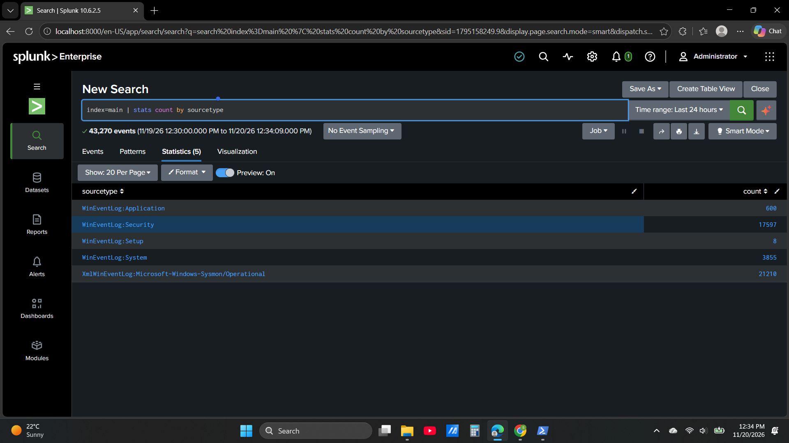
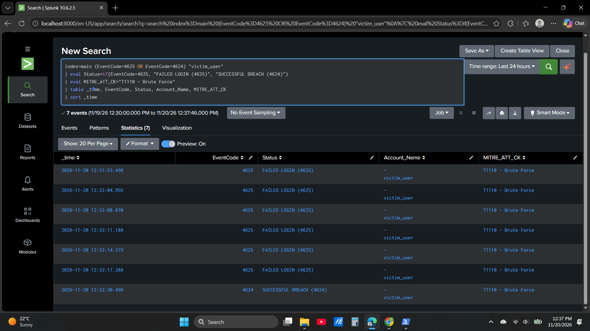
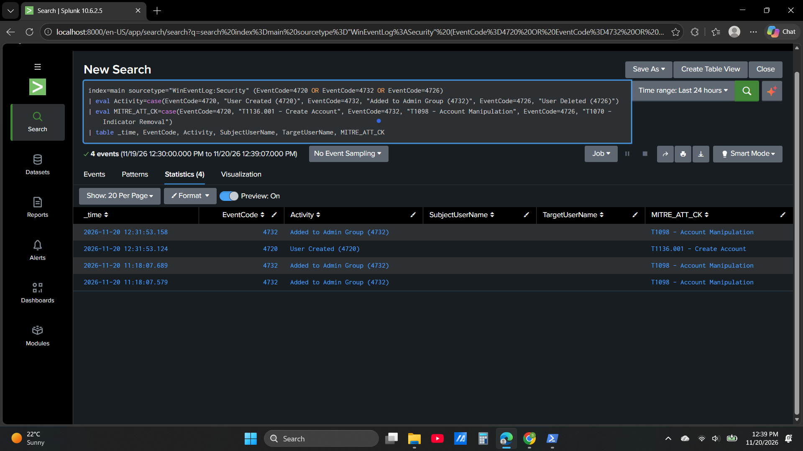
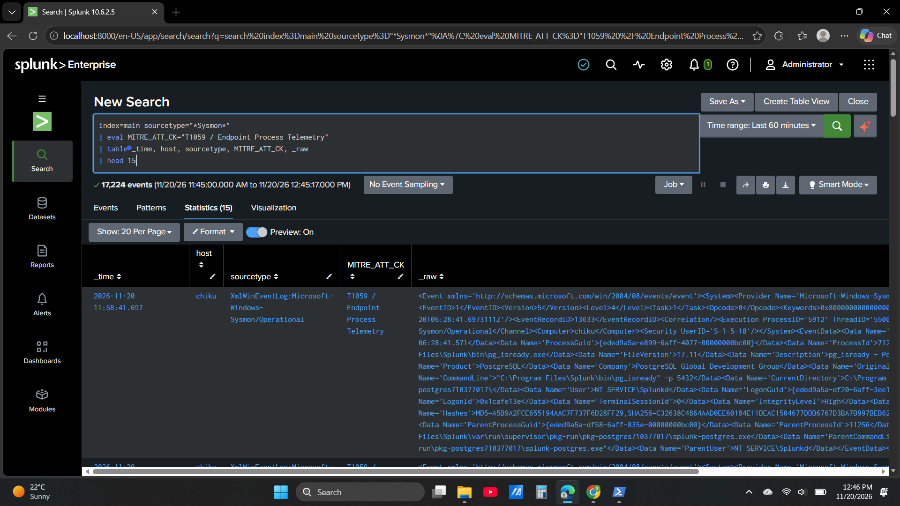
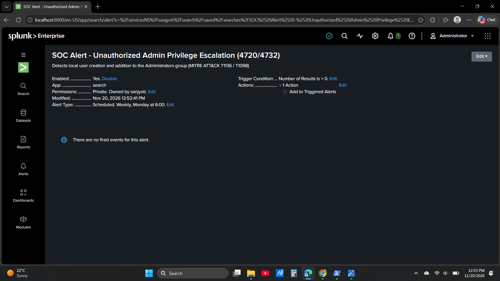
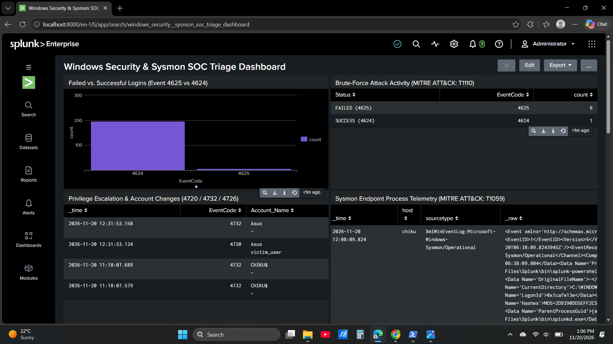

# 🛡️ Splunk SIEM: Windows Security Event Log & Sysmon Monitoring Lab

## 📌 Project Overview
This project implements an end-to-end **Security Operations Center (SOC)** monitoring, threat detection, and incident triage pipeline on a Windows endpoint using **Splunk Enterprise**, **Splunk Universal Forwarder**, and **Microsoft Sysmon**.

In this lab, I simulated real-world attack scenarios—including **credential brute-force attacks (`Event ID 4625` & `4624`)**, **unauthorized local administrator privilege escalation (`Event ID 4720` & `4732`)**, and **indicator removal (`Event ID 4726`)**—wrote custom **SPL (Search Processing Language)** detection rules mapped to the **MITRE ATT&CK® framework**, configured automated high-severity alerts, and built a real-time **SOC Triage Dashboard**.

---

## 🏗️ Lab Architecture
```text
[Windows 11 Endpoint]
 ├── Windows Security Event Logs (4624, 4625, 4720, 4732, 4726)
 └── Microsoft Sysmon (Sysmon64 + SwiftOnSecurity XML Ruleset)
          │
          ▼
[Splunk Universal Forwarder] ──(TCP Port 9997)──► [Splunk Enterprise SIEM]
                                                    ├── Custom SPL Detection Rules
                                                    ├── MITRE ATT&CK® Mapping
                                                    ├── Automated High-Severity Alerts
                                                    └── Real-Time SOC Triage Dashboard
```

---

## 🔧 Tools & Technologies
* **SIEM Platform:** Splunk Enterprise
* **Log Collection & Forwarding:** Splunk Universal Forwarder (`inputs.conf` & `outputs.conf`)
* **Endpoint Telemetry:** Microsoft Sysmon (`Sysmon64.exe` with `SwiftOnSecurity` configuration)
* **Detection Language:** Splunk Search Processing Language (SPL)
* **Threat Framework:** MITRE ATT&CK®

---

## 🚀 Detection Rules & Investigation Walkthrough

### 1. End-to-End Log Ingestion Verification
Configured Splunk Enterprise to listen on receiving port `9997` and configured the Universal Forwarder to ingest both Windows Security Event Logs and Sysmon Operational logs into `index=main`.

```spl
index=main | stats count by sourcetype
```


---

### 2. Brute-Force Attack Simulation & Detection (`MITRE ATT&CK: T1110`)
* **Attack Scenario:** Simulated an automated password-guessing attack generating multiple consecutive failed logon attempts (**Event ID 4625**) followed by a successful authentication (**Event ID 4624**).
* **Custom SPL Detection Query:**
```spl
index=main (EventCode=4625 OR EventCode=4624) "victim_user"
| eval Status=if(EventCode=4625, "FAILED LOGIN (4625)", "SUCCESSFUL BREACH (4624)")
| eval MITRE_ATT_CK="T1110 - Brute Force"
| table _time, EventCode, Status, Account_Name, MITRE_ATT_CK
| sort _time
```


---

### 3. Privilege Escalation & Indicator Removal (`MITRE ATT&CK: T1136.001, T1098, T1070`)
* **Attack Scenario:** Simulated post-compromise persistence by creating a rogue local user account (**Event ID 4720**), adding the user to the local `Administrators` group (**Event ID 4732**), and deleting the account to cover tracks (**Event ID 4726**).
* **Custom SPL Detection Query:**
```spl
index=main (EventCode=4720 OR EventCode=4732 OR EventCode=4726)
| eval Activity=case(EventCode=4720, "User Account Created (4720)", EventCode=4732, "Added to Local Admin Group (4732)", EventCode=4726, "User Account Deleted (4726)")
| eval MITRE_ATT_CK=case(EventCode=4720, "T1136.001 - Create Local Account", EventCode=4732, "T1098 - Account Manipulation", EventCode=4726, "T1070 - Indicator Removal")
| table _time, EventCode, Activity, Account_Name, MITRE_ATT_CK
| sort _time
```


---

### 4. Sysmon Endpoint Process Telemetry (`MITRE ATT&CK: T1059`)
* **Telemetry Monitoring:** Collected granular host-level execution events via Sysmon to track endpoint process activity alongside native Windows Security logs.
* **Custom SPL Query:**
```spl
index=main sourcetype="*Sysmon*"
| eval MITRE_ATT_CK="T1059 / Endpoint Process Telemetry"
| table _time, host, sourcetype, MITRE_ATT_CK, _raw
| head 15
```


---

### 5. Automated SOC Alerting
Created an automated scheduled alert in Splunk Enterprise to trigger a **High-Severity** alert whenever unauthorized account creation (`4720`) or local Administrator group escalation (`4732`) is detected (`Number of Results > 0`).



---

### 6. Real-Time SOC Triage Dashboard
Built a centralized 2×2 **SOC Triage Dashboard** displaying failed vs. successful login distribution, targeted brute-force accounts, privilege escalation activity, and real-time Sysmon host telemetry for rapid Tier-1/Tier-2 incident triage.



---

## 🔍 Root Cause Analysis (RCA) & Remediation

| Security Incident | Root Cause | Remediation & Hardening |
| :--- | :--- | :--- |
| **Brute-Force Compromise (`4625` → `4624`)** | Lack of an account lockout threshold and weak password complexity allowed repeated login attempts until success. | Configure Windows **Account Lockout Policy** (lock after 5 failed attempts for 15 minutes), enforce strong password policies, and enable MFA. |
| **Local Admin Escalation (`4720` / `4732`)** | Unmonitored execution of local user and group management commands (`net user`, `net localgroup`). | Enforce the **Principle of Least Privilege (PoLP)**, alert on `4720`/`4732` events in real time, and deploy Microsoft LAPS. |
